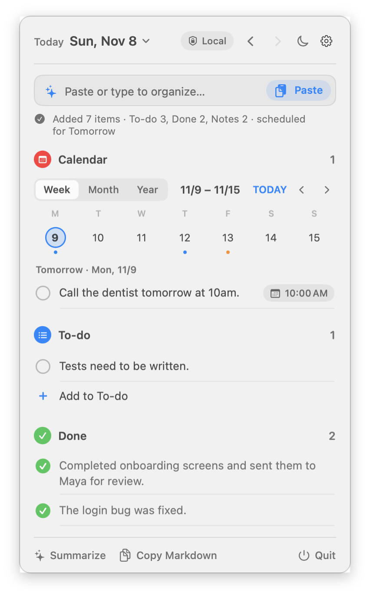
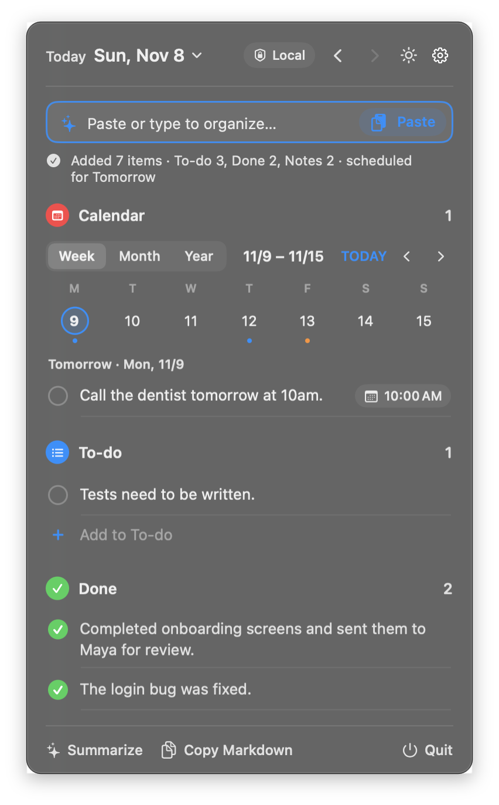

# TidyDay

A menu bar app for macOS that tidies up your day. Paste anything (meeting notes, chat logs, quick thoughts) and an on-device model sorts it into **Done**, **To-do** and **Notes**.

<p align="center">
  
  
</p>

[繁體中文說明](#繁體中文)

## Features

- **Paste and organize.** One click pastes your clipboard and splits it into items. Each item is classified as done, to-do or note.
- **Understands sentences with more than one thing.** "Fixed the login bug, but still need to write tests" becomes a done item and a to-do.
- **Checks off existing to-dos.** If you paste "sent the budget draft", TidyDay marks the matching open to-do as done.
- **To-dos carry over.** Unfinished to-dos stay on your list across days until you check them off.
- **Calendar.** Items that mention a time ("call the dentist tomorrow at 10am", "by Friday") get a date. A week, month or year view shows what is coming up. Click a time label to add the item to the macOS Calendar app.
- **Menu bar count.** The menu bar icon shows how many to-dos need your attention today.
- **Global shortcut.** Press ⌃⌥T from any app to open TidyDay with the cursor in the input box. You can turn this off in ⚙️.
- **Daily summary.** Generates a short summary of the day. You can copy the whole day as Markdown.
- **On-device by default.** Uses Apple Intelligence (Foundation Models) on your Mac. It is free, works offline, and nothing leaves your machine.
- **Optional other models.** You can switch to OpenAI, Claude, Gemini, OpenRouter or Ollama. API keys are stored in the macOS Keychain.
- **Languages.** The interface and the model output support English, 繁體中文, 简体中文 and 日本語. The default follows your system language.
- **Light and dark mode.** Follows the system by default. The moon icon switches it.
- **Two layouts.** A list (default) or tabs.

## Requirements

- A Mac with Apple silicon (M1 or later)
- macOS 26 or later
- Apple Intelligence turned on (System Settings → Apple Intelligence & Siri) for the on-device model

Without Apple Intelligence you can still use a cloud model or Ollama. If no model is available, pasted text is saved as a note as-is.

## Install

Download the `.dmg` from [Releases](../../releases) and drag TidyDay to Applications.

The app is not signed with an Apple Developer ID yet, so macOS blocks the first launch. To open it, do one of these:

- Open **System Settings → Privacy & Security**, scroll down and click **Open Anyway** next to TidyDay.
- Or run this in Terminal:
  ```sh
  xattr -dr com.apple.quarantine /Applications/TidyDay.app
  ```

TidyDay has no window. Look for the checklist icon in the menu bar. It sets itself to launch at login the first time it runs; you can turn this off in ⚙️.

## Build from source

You need Xcode 26 or later.

```sh
./build.sh            # builds build/TidyDay.app
./build.sh install    # builds, installs to ~/Applications and launches
./build.sh dist       # builds build/TidyDay-<version>.dmg
```

To sign and notarize with your own Developer ID:

```sh
SIGN_ID="Developer ID Application: Your Name (TEAMID)" NOTARY_PROFILE=notary ./build.sh dist
```

## How organizing works

The on-device model is small, so TidyDay does not trust a single answer. It works in steps:

1. The model quotes the original words for each item, notes the words that decide the tense ("finished", "by Friday"), and then picks done, to-do or note.
2. TidyDay checks the result with simple rules: a sentence with both finished and unfinished parts, a done item that only says "need to", lines that no item covers, invented or duplicated items.
3. Only the sentences with a problem go back to the model for a second look.

Dates are read from your original text with the system date parser, not by the model.

The `eval/` folder has 112 test cases in English, Chinese and Japanese, including chat logs, meeting notes and sentences with more than one thing. Run them with:

```sh
eval/run.sh 3        # every case, 3 times each (about 20 minutes)
eval/run.sh 2 mi-    # only the cases whose id starts with mi-
```

The last run scored 96.7% (the previous single-prompt version scored 84.2%).

## Privacy

- Your entries are stored as one JSON file per day in `~/Library/Application Support/TidyDay/days/`.
- With the on-device model, or Ollama on `localhost`, nothing leaves your Mac.
- With a cloud model, the text you organize is sent to that provider. The settings page shows a warning when this applies.
- API keys are kept in the macOS Keychain and never written to a settings file.
- Calendar access is write-only. TidyDay can add events when you click a time label, but it cannot read your existing events.

## Known limitations

- The on-device model is small and still makes mistakes, about 3 in 100 items in the test set. For example, it may split a chat thread into a to-do and a done item instead of one. You can right-click an item to move it.
- Organizing takes about 3 seconds, because TidyDay double-checks unclear sentences.
- Removing a to-do does not remove an event you already added to Calendar.
- Switching the language does not translate items you have already saved.

## License

[MIT](LICENSE)

---

## 繁體中文

TidyDay 是常駐在 macOS 選單列的小工具。把會議紀錄、聊天內容、隨手筆記貼上，本地模型會自動整理成**已完成**、**待辦**、**筆記**。

- **貼上並整理**：一鍵貼上剪貼簿內容，自動拆成條列並分類。
- **一句話多件事也能拆開**：「bug 修好了但還沒部署」會變成一筆已完成、一筆待辦。
- **自動勾掉待辦**：貼上「預算草稿寄出了」，對應的待辦會自動標成完成。
- **待辦跨天延續**：沒做完的會一直留著，直到你勾掉。
- **行事曆**：提到時間的事（「明天下午 3 點開會」「週五前」）會自動記下日期，可以用週、月、年檢視；點時間標籤就能加到 macOS 行事曆。
- **選單列數字**：圖示上顯示今天要處理的待辦數。
- **全域快捷鍵**：在任何 App 按 ⌃⌥T 叫出 TidyDay，直接輸入。
- **每日總結**：產生幾句話的當日摘要，也可以整天複製成 Markdown。
- **預設用 Mac 本地模型**：免費、不用網路，內容不會離開你的電腦。也可以改用 OpenAI、Claude、Gemini、OpenRouter 或 Ollama，API key 存在鑰匙圈。
- **多國語系**：介面和模型輸出支援繁中、简中、English、日本語，預設跟隨系統。

**需要的環境**：Apple 晶片的 Mac、macOS 26 以上；要用本地模型的話，需要開啟 Apple Intelligence。

**安裝**：從 [Releases](../../releases) 下載 DMG，把 TidyDay 拖到「應用程式」。這版還沒有 Apple 開發者簽章，第一次打開會被擋下來，請到「系統設定 → 隱私權與安全性」按「仍要打開」。
